<div align="center">


# Kapsül

**Notların, ses kayıtların, fotoğrafların ve belgelerin için tamamen cihazında çalışan kişisel dijital hafıza.**

*A local-first, privacy-focused personal memory app for Android — built with Jetpack Compose and Material 3 Expressive.*

[](#kurulum)
[](https://kotlinlang.org)
[](https://m3.material.io)
[](LICENSE)
[](https://github.com/TozluMercek/Kapsul/releases/latest)

### [⬇️ APK'yı indir](https://github.com/TozluMercek/Kapsul/releases/latest)

</div>

---

## Neden Kapsül?

Aklına gelen bir fikir, bir sesli not, bir fatura fotoğrafı, taranmış bir belge… Kapsül hepsini tek bir yerde toplar,
**başlıklarını ve etiketlerini kendisi atar**, ilgili notları birbirine bağlar ve "Geçen ay ev tamiri için hangi
malzemeyi konuşmuştuk?" gibi sorulara notlarının içinden yanıt bulur.

Hepsi **telefonunda** olur: notların hiçbir sunucuya gönderilmez. İnternete bağlanan tek özellik, isteğe bağlı hava durumudur.

## Ekran görüntüleri

<table>
  <tr>
    <td align="center">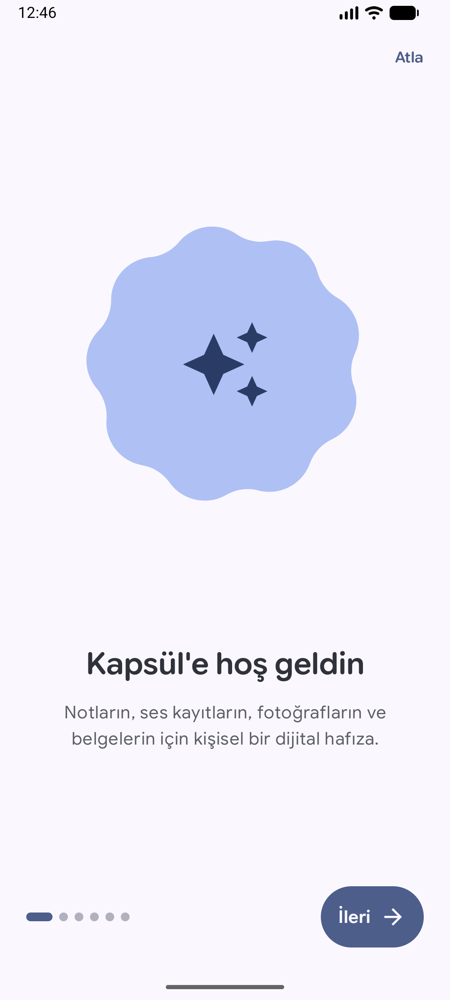<br /><sub>Kaydırmalı tanıtım</sub></td>
    <td align="center">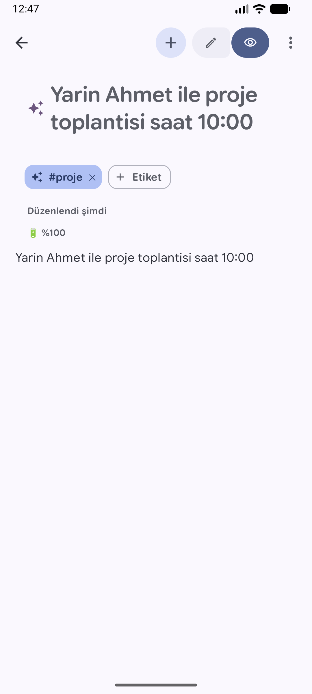<br /><sub>Otomatik başlık, etiket ve bağlam</sub></td>
    <td align="center">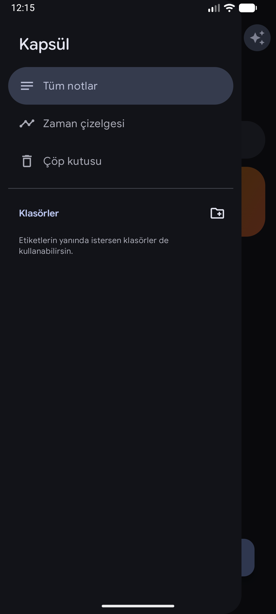<br /><sub>Menü ve klasörler</sub></td>
    <td align="center">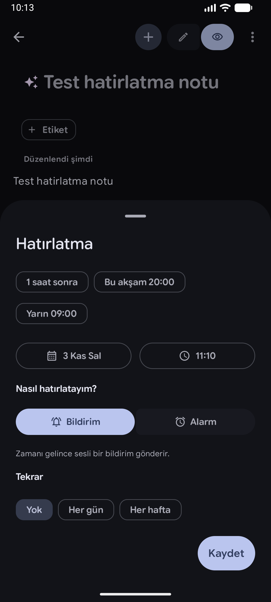<br /><sub>Hatırlatma ve alarm</sub></td>
  </tr>
  <tr>
    <td align="center">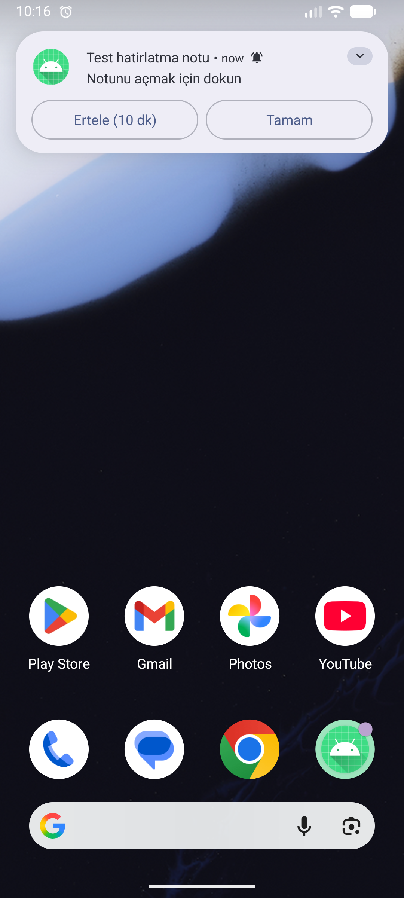<br /><sub>Alarm bildirimi</sub></td>
    <td align="center">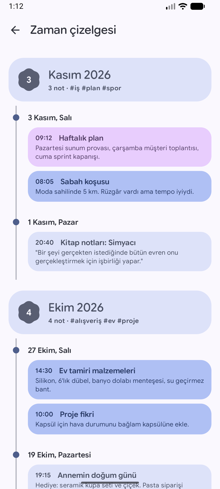<br /><sub>Zaman çizelgesi</sub></td>
    <td align="center">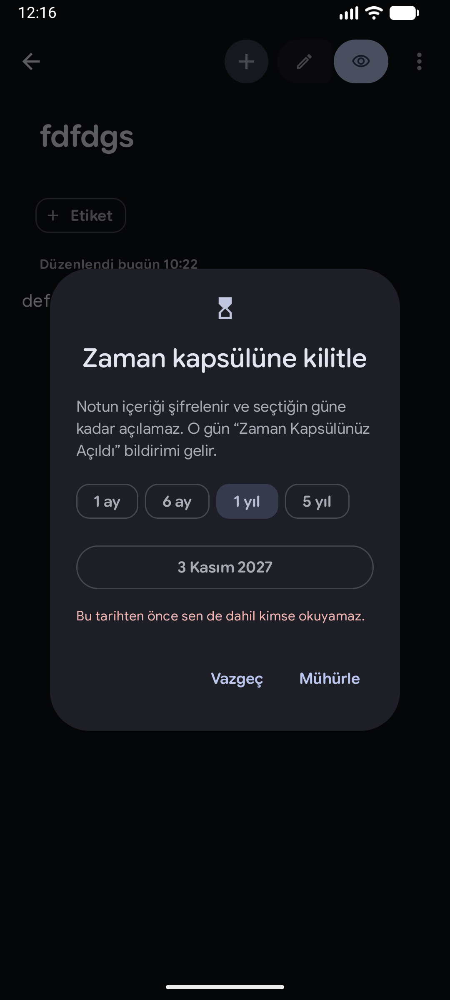<br /><sub>Zaman kapsülü</sub></td>
    <td align="center">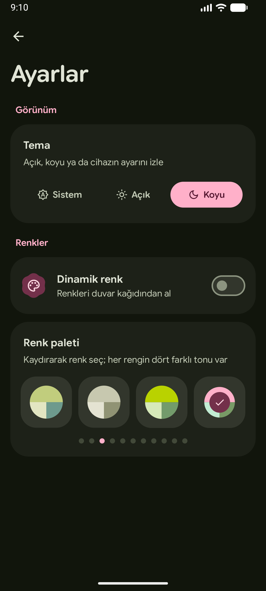<br /><sub>44 renk paleti</sub></td>
  </tr>
  <tr>
    <td align="center">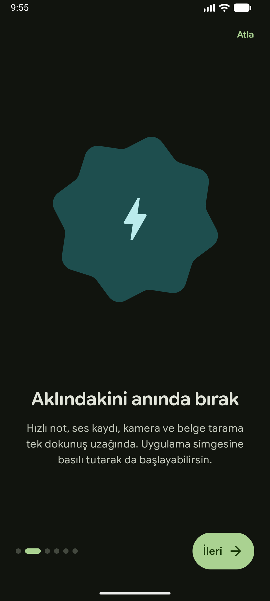<br /><sub>Şekil dönüşümlü tanıtım</sub></td>
    <td align="center">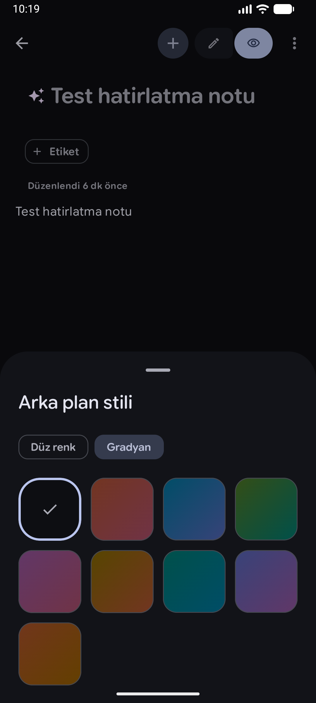<br /><sub>Arka plan stili</sub></td>
    <td align="center">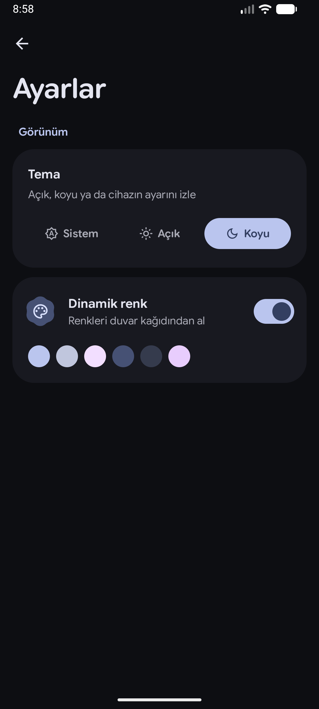<br /><sub>Koyu tema ve ayarlar</sub></td>
    <td></td>
  </tr>
</table>

## Özellikler

### 🧠 Akıllı not alma
- **Hızlı not** — tek dokunuşla yaz ya da sesini kaydet; uygulama simgesine basılı tutarak da başlatılabilir.
- **Otomatik başlık ve etiket** — sen yazarken cihaz üzerinde, Türkçeye uygun kurallarla oluşturulur (`#toplantı`, `#alışveriş`, `#proje`…).
- **Markdown** — başlıklar, listeler, yapılacaklar, kod blokları, alıntılar ve tablolar.
- **Çift yönlü bağlantılar** — `[[Not adı]]` yazınca notlar birbirine bağlanır; benzer notlar için "Bağlayayım mı?" önerisi gelir.
- **Hafızana sor** — notların arasında doğal dille ara; "Kaydet: …" yazarak sohbetten not oluştur.

### 📎 Ekler
PDF (uygulama içi okuyucu), ses kaydı, galeri, kamera, **belge tarama** (ML Kit), ses dosyası, **çizim**,
yapışkan not ve tablo — notun ⋮ / ➕ menüsünden.

### 🎧 Ses kayıtları
Ses dalgası (waveform) üzerinde dokunarak/sürükleyerek gezinme, **1x · 1.25x · 1.5x · 2x** oynatma hızı ve
**sessiz kısımları otomatik atlama** — hepsi kayıt cihazda çözümlenerek.

### ⏰ Hatırlatmalar
- **Bildirim** ya da **alarm** (kapatılana kadar çalar, kilit ekranında tam ekran açılır).
- Tekrar: yok / her gün / her hafta; bildirimden **10 dk ertele**.
- Telefon yeniden başlasa da hatırlatmalar korunur; hatırlatmalı notlar kartta belirgin bir etiketle görünür.

### 🔒 Gizlilik
- **Not kilitleme** — parmak izi, yüz tanıma veya cihaz PIN'i ile.
- **Zaman kapsülü** — notu ileri bir tarihe (1 ay, 1 yıl, 5 yıl…) kadar **AES-256 ile şifreleyip mühürle**;
  o gün gelince "Zaman Kapsülünüz Açıldı" bildirimi ve açılış animasyonu.
- Kilitli ve mühürlü notlar aramaya ve "Hafızana sor"a dahil edilmez.

### 🌌 Bağlam kapsülü
Her yeni nota o anın küçük bir fotoğrafı eklenir: 🎵 çalan şarkı, 🔋 pil, 👣 günlük adım, 📍 semt, ⛅ hava durumu.
Yıllar sonra "bunu yazarken neredeydim, ne dinliyordum?" sorusuna yanıt verir. Her biri isteğe bağlıdır.

### 🗂️ Düzen
- **Klasörler** — etiketlerin yanında isteğe bağlı, iç içe klasörler.
- **Zaman çizelgesi** — notlar ay ay, gün gün; "o dönemde nelerle meşguldüm?" sorusuna görsel yanıt.
- **Çöp kutusu** — silinen notlar 30 gün saklanır ve geri yüklenebilir.
- **Pano önerisi** — kopyaladığın metni tek dokunuşla not yap.
- Uzun basarak çoklu seçim: sil, klasöre taşı.

### 🎨 Görünüm
- **Material 3 Expressive** — şekil dönüşümleri (shape morphing), ifadeci hareket, yeni bileşenler.
- **Google Sans Flex** değişken yazı tipi (yuvarlak başlıklar, okunaklı gövde metni).
- Açık / koyu / sistem teması, **AMOLED tam siyah**, duvar kağıdından **dinamik renk** ve **44 renk paleti**.
- Not başına **arka plan stili**: 12 düz renk, 8 gradyan.

## Gizlilik

| | |
|---|---|
| 🌐 İnternet | Yalnızca isteğe bağlı **hava durumu** için (varsayılan kapalı): [Open-Meteo](https://open-meteo.com)'ya ~1 km'ye yuvarlanmış konum gönderilir. Not içeriği asla gönderilmez. |
| 💾 Veri | Notlar ve ekler yalnızca uygulamanın özel depolama alanında (Room/SQLite) tutulur. |
| 🔐 Şifreleme | Zaman kapsülleri, Android Keystore'daki donanım destekli anahtarla AES-256-GCM ile şifrelenir. |
| 🧠 Zekâ | Başlık, etiket, ilgili not bulma ve arama tamamen cihazda (TF-IDF + kurallar) çalışır. |

<details>
<summary><b>İzinler ve neden gerektikleri</b></summary>

| İzin | Ne için | Ne zaman istenir |
|---|---|---|
| `RECORD_AUDIO` | Ses kaydı | İlk kayıtta |
| `POST_NOTIFICATIONS` | Hatırlatma bildirimleri | İlk hatırlatmada |
| `SCHEDULE_EXACT_ALARM` | Hatırlatmaların tam zamanında çalması | Hatırlatma kaydedilince (ayar bağlantısı) |
| `USE_FULL_SCREEN_INTENT` | Kilit ekranında tam ekran alarm | Alarm türü seçilince |
| `RECEIVE_BOOT_COMPLETED` | Yeniden başlatmadan sonra hatırlatmaları geri kurmak | — |
| `ACTIVITY_RECOGNITION` | Bağlam kapsülü: adım sayısı (isteğe bağlı) | Ayarlardan açılınca |
| `ACCESS_COARSE_LOCATION` | Bağlam kapsülü: yaklaşık semt ve hava durumu (isteğe bağlı) | Ayarlardan açılınca |
| `INTERNET` | Bağlam kapsülü: hava durumu (isteğe bağlı, yalnızca Open-Meteo) | — |
| Bildirim erişimi | Bağlam kapsülü: çalan şarkı (isteğe bağlı) — bildirimler okunmaz | Ayarlardan açılınca |
| Biyometri | Not kilidi | Kilit açılırken |

</details>

## Kurulum

1. [Releases](https://github.com/TozluMercek/Kapsul/releases/latest) sayfasından telefonuna uygun APK'yı indir. Emin değilsen `universal` olanı seç; günümüz telefonlarının çoğu için `arm64-v8a` yeterlidir (`armeabi-v7a` eski 32 bit telefonlar, `x86` / `x86_64` emülatör ve bazı tabletler içindir).
2. Telefonunda dosyayı aç; gerekirse "bilinmeyen kaynaklardan yükleme" iznini ver.
3. Android **7.0 (API 24)** veya üzeri gerekir. Belge tarama için Google Play hizmetleri gerekir.

## Kullanılan teknolojiler

| Alan | Kütüphane | Sürüm |
|---|---|---|
| Dil | [Kotlin](https://kotlinlang.org) | 2.2.10 |
| Arayüz | [Jetpack Compose](https://developer.android.com/jetpack/compose) (BOM) | 2026.02.01 |
| Tasarım | [Material 3 Expressive](https://m3.material.io) (`material3`) | 1.5.0-beta02 |
| İkonlar | Material Icons Extended | 1.7.8 |
| Renk | [MaterialKolor](https://github.com/jordond/MaterialKolor) — tohum renkten tam renk şeması | 4.0.5 |
| Veritabanı | [Room](https://developer.android.com/training/data-storage/room) + KSP | 2.8.4 / 2.3.6 |
| Mimari | Lifecycle ViewModel, Kotlin Coroutines & Flow | 2.11.0 |
| Belge tarama | [ML Kit Document Scanner](https://developers.google.com/ml-kit/vision/doc-scanner) | 16.0.0 |
| Kimlik doğrulama | [AndroidX Biometric](https://developer.android.com/jetpack/androidx/releases/biometric) | 1.1.0 |
| Yazı tipi | [Google Sans Flex](https://fonts.google.com/specimen/Google+Sans+Flex) (SIL OFL 1.1) | — |
| Hava durumu | [Open-Meteo](https://open-meteo.com) — API anahtarı gerektirmez, `HttpURLConnection` ile | — |
| Derleme | Android Gradle Plugin | 9.5.0 |

Platform API'leri: `AlarmManager`, `MediaRecorder` / `MediaPlayer` / `MediaCodec` (ses dalgası çözümleme),
`PdfRenderer`, `BiometricPrompt`, Android Keystore, `MediaSessionManager`, `SensorManager`.

## Proje yapısı

```
app/src/main/java/com/example/kapsul/
├── data/            # Room varlıkları, DAO, depo, ayarlar, eklerin dosya deposu
├── intelligence/    # Cihaz üstü zekâ: başlık, etiket, ilgili notlar, arama, "hafızana sor"
├── capsule/         # Zaman kapsülü şifrelemesi, bağlam kapsülü toplayıcısı
├── reminders/       # Zamanlayıcı, bildirimler, alarm ekranı, yeniden başlatma alıcısı
└── ui/
    ├── home/        # Ana ekran, çekmece menü, çoklu seçim, pano önerisi
    ├── editor/      # Not editörü, Markdown araç çubuğu
    ├── attachments/ # Ekleme menüsü, ses kaydedici/oynatıcı, çizim, PDF/görüntü görüntüleyici
    ├── privacy/     # Kilit ekranı, zaman kapsülü ekranları ve animasyonu
    ├── folders/ timeline/ trash/ background/ reminders/ settings/ onboarding/ ask/ capture/
    └── theme/       # Material 3 Expressive tema, Google Sans Flex tipografisi
```

## Kaynaktan derleme

```bash
git clone https://github.com/TozluMercek/Kapsul.git
cd Kapsul
./gradlew assembleDebug        # app/build/outputs/apk/debug/
./gradlew testDebugUnitTest    # birim testleri
```

İmzalı release için proje köküne `keystore.properties` ekle (git'e girmez):

```properties
storeFile=/yol/kapsul-release.jks
storePassword=…
keyAlias=kapsul
keyPassword=…
```

```bash
./gradlew assembleRelease      # app/build/outputs/apk/release/
```

## Bilinen sınırlamalar

- Zaman kapsülünün açılış tarihini doğrulayan bir sunucu yoktur; kilit cihaz saatine güvenir.
- "Hafızana sor" bir dil modeli değil, cihaz üstü arama ve alıntılamadır; zekâ katmanı `NoteIntelligence`
  arayüzünün arkasında olduğu için ileride cihaz üstü bir modelle değiştirilebilir.

## Teşekkürler

- Yazı tipi: **Google Sans Flex** — SIL Open Font License 1.1 ([lisans metni](app/src/main/assets/licenses/GoogleSansFlex-OFL.txt)).

## Lisans

Kapsül [MIT Lisansı](LICENSE) ile dağıtılır. Google Sans Flex yazı tipi kendi lisansına (SIL OFL 1.1) tabidir.
